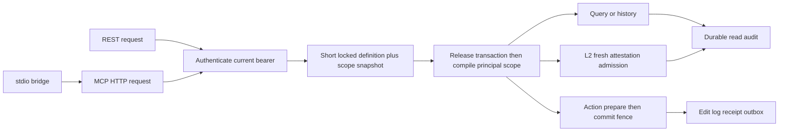

# Phase 07: REST & MCP Shell - Research
**Researched:** 2026-10-29（Asia/Shanghai；证据日志跨 2026-10-28/29）
**Domain:** Rust REST/OpenAPI/MCP 服务外壳、clients 与发行
**Confidence:** HIGH（rmcp 可行性）；MEDIUM（其余接线方案）

<user_constraints>
## User Constraints (from CONTEXT.md)
以下原文来自本次已读取的 `07-CONTEXT.md`，不重新裁决已接受合同。[VERIFIED: .planning/phases/07-rest-mcp-shell/07-CONTEXT.md:15-38]
<!-- DATA_7F3A9C21_START -->
### MCP stdio 运行方式
- **D-01:** stdio 作为认证桥接，连接已经运行的 `serve`，共享服务状态、权限和审计。MCP 客户端使用前需要先启动 `serve`。
### dev 数据生命周期
- **D-02:** `serve --dev` 默认保留 Action 修改和历史，需要时显式重置。重启不能静默恢复初始数据。
### 工程审查事项
健康状态已接受，见下节。优雅关闭、桥接认证与取消边界、跨进程 reload 和每请求定义快照继续接受工程审查。Grok 输出属于第二意见，不代表用户接受或实现已经验证。
### 服务健康契约
- **D-03:** 用户选择工程审查 D1 的选项 1：仅已配置的 L2 故障、L0 查询和 Action 仍正常时，`/health` 返回 HTTP 200，正文标记 `degraded` 并暴露脱敏的 L2 禁用原因，监控须检查正文。核心能力故障时返回 HTTP 503。L2 故障期间继续 fail-closed；未配置的可选 L2 不算意外故障。
### Deferred Ideas
无本次新增的范围外想法。ontology 级强类型 SDK 仍按 ADR-0009 留待 MVP 之后，不能与本阶段 Rust/TS 平台层 client 混淆。
<!-- DATA_7F3A9C21_END -->
CONTEXT 未单列 discretion；实施细节按已完成工程审查与现有 ADR 收敛。完整范围保留 Rust/TS clients、release、L2-04/SCOPE-07 服务级验收。[VERIFIED: 07-CONTEXT.md:7-11; 07-ENG-REVIEW.md]
</user_constraints>

## Summary
使用同一个认证宿主提供 REST 与 /mcp，stdio 仅桥接已有服务。rmcp 3.8.0、axum 0.8.9 的独立 workspace 已真实编译运行：4 unit + 1 stdio 子进程测试通过；动态 Action schema、两个 principal 的工具过滤、直接越权拒绝、HTTP extensions 身份、旧协议 session 隔离、新协议无 session、取消及 EOF 关闭均有证据。[VERIFIED: spikes/rmcp-shell/final.log; spikes/rmcp-shell/transport-fixed.log]
首条实施 tracer 必须贯通真实 auth → HTTP → 原子 metadata snapshot → Query → durable read audit；随后扩展 Action/history，再接 MCP、clients、dev 和 release。这是依据工程审查的规划建议，不是已交付功能。[VERIFIED: 07-ENG-REVIEW.md]
GSD research-plan 返回 Context7；已执行 library → docs 并缓存四份 digest。classify-confidence(context7, verified, package=rmcp, ecosystem=crates) 返回 HIGH；无 package 参数返回 MEDIUM。graphify 未启用，agent_skills 配置为空。[VERIFIED: 本次 GSD CLI 输出]

## Architectural Responsibility Map
| Capability | Primary Tier | Secondary Tier | 规划责任 |
|---|---|---|---|
| 认证、请求快照、错误映射 | API / Backend | Storage | REST/MCP 共用宿主入口 |
| 对象、Action、历史、L2 | 既有业务服务 | Storage / Trino | 适配外壳不复制权限算法 |
| 动态工具与 transport | API / Backend | stdio bridge | 每次请求重鉴权，session 不作凭据 |
| Rust/TS client | Client | OpenAPI | 平台能力完整覆盖，生成类型加可调用 wrapper |
| 健康、dev、关闭、发行 | Process / CI | Storage / Engine | 明确拥有后台任务与持久文件 |
以上为工程审查约束导出的责任建议。[VERIFIED: 07-ENG-REVIEW.md; ADR-0007; ADR-0009]

## Standard Stack
| Package | 推荐锁定版本 / feature | 当前版本发布时间 | 证据 |
|---|---|---|---|
| rmcp | =3.8.0；default-features=false；server, client, transport-io, transport-streamable-http-server, transport-streamable-http-client-reqwest, reqwest | 2026-10-26 | cargo info + crates.io API + 官方 rust-sdk；spike 已编译 [VERIFIED: crates.io] |
| axum | =0.8.9；json, tokio, http1，按需保留默认 feature | 2026-04-14 | cargo info + 官方仓库；spike 已编译 [VERIFIED: crates.io] |
| utoipa / utoipa-axum | =6.0.0 / =0.3.0；utoipa macros, axum_extras | 2026-09-22 | 官方文档、下载源码 manifest 与 cargo info；未编译本项目 DTO [VERIFIED: crates.io] |
| tokio-util | 0.7.20；rt（CancellationToken / TaskTracker） | 未记录版本发布日期 | cargo info、rmcp 官方源码依赖；spike 已编译 [VERIFIED: crates.io] |
| reqwest / tokio / serde_json | 沿用 workspace 0.13.5 / 1.53.3 / 1.0.154；reqwest 禁默认 TLS，rustls；宿主补 tokio macros, rt-multi-thread, signal, net, io-std | 保持已有约束 | workspace 已声明，独立 spike Tokio 实际解析为 1.54.1，不表示升级根 lock [VERIFIED: Cargo.toml:16-44; spikes/rmcp-shell/Cargo.lock] |
| openapi-typescript / openapi-fetch | 7.13.0 / 0.17.0 | 均 2026-02-11 | 官方 openapi-ts 文档发现，npm view 核验 [VERIFIED: npm registry] |
| typescript | 7.0.2；Node >=16.20.0 声明，本机 Node 24.22.1 | 2026-07-08 | 官方文档推荐依赖 + npm view [VERIFIED: npm registry] |
不替换锁定的 axum/utoipa/rmcp 或 clients 路线；不新增 SDK generator。推荐依赖由执行阶段按 workspace 模式接入并锁根 Cargo.lock。[VERIFIED: ADR-0007; ADR-0009]

## Package Legitimacy Audit
本次对 rmcp、axum、utoipa、utoipa-axum、tokio-util、tower、tokio、reqwest、serde、serde_json 运行 crates gate，对 openapi-typescript、openapi-fetch、typescript 运行 npm gate，全部 OK。前四项以 cargo info + crates.io API 核实版本，其余沿用 workspace 或独立 lock；npm 三项 npm view 同时检查版本与 scripts.postinstall，未返回 postinstall 值。该观察不证明包没有其他安装行为。[VERIFIED: 本次 package-legitimacy / cargo info / npm view 输出]
| Registry | Package 首次发布时间 / gate 下载量字段样例 | Source Repo | Verdict / Disposition |
|---|---|---|---|
| crates | rmcp 2025-03-16 / 1818802；axum 2021-07-22 / 11227421 | modelcontextprotocol/rust-sdk；tokio-rs/axum | OK / Approved |
| crates | utoipa 2022-01-27 / 1560117；utoipa-axum 2024-09-01 / 343251 | juhaku/utoipa | OK / Approved |
| npm | openapi-typescript 9354338；openapi-fetch 9940255；typescript 267244286 | openapi-ts/openapi-typescript；microsoft/TypeScript | OK / Approved |
表中下载数是 seam 原样返回的 weeklyDownloads 字段，不自行解释为 crates 的真实周下载统计。SLOP removed: none；SUS: none。[VERIFIED: 本次 gate JSON]

## Architecture Patterns

这是推荐数据流，不代表现有外壳已实现；依据已接受工程审查。[VERIFIED: 07-ENG-REVIEW.md]

### 快照与定义固定
增加最小 storage request_snapshot 入口，复用共同定义锁，在同一短事务读 definition + roles + bindings，事务返回前结束；scope 编译、source 网络请求、SSE、响应发送不得持锁。源码原文为 `begin_definition_tx`、`set_local_lock_timeout`、`advisory_xact_lock`，scope apply 使用同一锁；现有 `load_scope` 仅自行 begin_write。[VERIFIED: crates/ontoforge-storage/src/reload.rs:182-200; scope_store.rs:420-424,507-544]
PG 分支当前原文为 `.begin()`，SQLite 为 `.begin_with(BEGIN_IMMEDIATE)`；不能仅把多个 SELECT 包在 PG 普通事务便宣称已获得一致快照。遵守审查批准的共同锁方案。[VERIFIED: crates/ontoforge-storage/src/sql_exit.rs:63-77; 07-ENG-REVIEW.md]
Query 已持有原文 `pub active: Arc<ActiveDefinition>`；Action/result/history 需增加接收固定定义的最小入口，保留旧 wrapper，共用内部逻辑。现有 result 会调用 `current_action_definition()`，history 调用 `active_definition()`。[VERIFIED: crates/ontoforge-query/src/lib.rs:231-239; crates/ontoforge-action/src/lib.rs:179-206; crates/ontoforge-storage/src/history.rs:107-119]
保留提交原文 `self.fence(&mut tx, input.commit.def_version)`，validate-only 同样经过 fence/CAS/guard；stale 返回结构化冲突，不切换版本自动重试写入。replay/result 检查本次 grant 与当前定义 Action 存在性，保留原 receipt/time，不能绑定原定义版本或追加当前行可见性检查。已有测试原文 `replay_across_clock_and_definition_change_keeps_winner_time` 与 `assert_eq!(first, second)`。[VERIFIED: commit.rs:615-674; crates/ontoforge-action/tests/idempotency.rs:237-285; 07-ENG-REVIEW.md]
history 已有定义版本证据由工程审查确认，本阶段不以此新增迁移；history 的当前可见性要求仍须保留，不能混同 command replay。[VERIFIED: 07-ENG-REVIEW.md; history.rs:100-106]

### DTO / OpenAPI / clients
建议 ontoforge-api 只保留轻量 serde + ToSchema wire DTO，server 显式转换到业务类型，移除 client 被迫引入 query/engine/storage 的依赖方向。当前 api manifest 确实依赖 query，Rust client 依赖 api。[VERIFIED: crates/ontoforge-api/Cargo.toml; crates/ontoforge-client/Cargo.toml; ADR-0009]
明确 DTO：元数据投影、ObjectSet/WhereClause、pk/list/aggregate、Action items/validateOnly/commandId/result、历史页、统一错误、health。永不接受 principal、roles、scope、limits 作为客户端可信字段；ActionRequest 原文 `action`、`command_id`、`items`、`validate_only`，ActionItem 原文 `params`、`expected_versions`。[VERIFIED: crates/ontoforge-action/src/lib.rs:40-57]
Schema 风险：utoipa serde 支持是部分支持；递归 ObjectSet/WhereClause 要 no_recursion 并完整注册引用；Value 表示任意 JSON，Object 仅 object；override 文档类型不改变 serde 编码。显式断言 openapi=3.1.0，不能因 utoipa 6 支持 3.2 而漂移。nullable、required、deny_unknown_fields、tagged union、递归、additionalProperties 都做正反例和生成后 tsc。[CITED: https://docs.rs/utoipa/6.0.0/utoipa/derive.ToSchema.html; https://github.com/juhaku/utoipa]
现有编码原文 `Self::Decimal(s) | Self::String(s) | Self::Date(s) | Self::Timestamp(s) => Value::String(s.clone())`，整数 `Self::Int(i) => Value::from(*i)`。保持 decimal 字符串和当前整数 wire 编码。[VERIFIED: crates/ontoforge-storage/src/value.rs:73-89]
Node 实测普通 JSON.parse 把 9007199254740993 变为 9007199254740992；JSON.parse reviver context.source + BigInt + JSON.rawJSON 可原样往返。TS wrapper 必须显式解决 long/seq/version 大整数，结合 openapi-typescript transform 及 lossless body codec；不得直接把 number 类型当作全范围保证。该原生方案只验证 Node24，浏览器能力须执行阶段测试/声明运行时要求，不能静默改 wire 编码。[VERIFIED: spikes/rmcp-shell/numbers.cjs:1-14; spikes/rmcp-shell/numbers.log]
TS 推荐创建独立 package，npm lock 入库；命令用 `npm ci`、`npx openapi-typescript <openapi.json> -o <generated.ts>`、`npx tsc --noEmit`、`node --test <compiled-contract-tests>`。开启 strict/noUncheckedIndexedAccess；提供 openapi-fetch wrapper、每实例 bearer、typed errors、abort，测试每个端点组。[CITED: https://openapi-ts.dev/introduction; https://openapi-ts.dev/openapi-fetch/api]

### MCP transport / auth / cancellation
rmcp 3.8 的 ServerHandler 手写 list_tools/call_tool 支持运行时 Tool::new JSON Schema；不必用静态 tool macro。从 context.extensions 的 HTTP Parts 再取 parts.extensions 的已认证主体，不能信 arguments 中的身份。list 和 call 复用工具授权/名称检查，先过滤再分页。[VERIFIED: spikes/rmcp-shell/src/lib.rs:68-142; final.log]
新协议 2026-07-28 删除 initialize/session 生命周期，使用 per-request metadata；必须发送 Mcp-Method 与 MCP-Protocol-Version。首次探针缺 Mcp-Method 真返回 400，修正后无 session 的两个主体请求通过。旧协议仍有 session，须绑定最初 principal，并在 POST/GET/DELETE 逐次认证；正式 owner map 需要容量/过期/删除回收，spike map 不是生产实现。[VERIFIED: spikes/rmcp-shell/transport.log; transport-fixed.log; rmcp-3.8.0/src/transport/streamable_http_server/tower.rs:78-110]
stdio 使用 AsyncRwTransport<RoleServer> 与 StreamableHttpClientTransport<RoleClient> 双向转发，保留 JSON-RPC IDs 和取消通知；stdout 仅协议。auth_header 接收不含 Bearer 前缀的 token。显式关闭 reqwest redirects 和 reinit_on_expired_session(false)，后者默认 true 且可能重发失败 POST；凭据不放命令行/日志。[VERIFIED: spikes/rmcp-shell/src/lib.rs:145-202; tests/process.rs; rmcp-3.8.0/src/transport/streamable_http_client.rs:2123-2170,2221-2235]
取消不能被等待长请求响应的串行转发堵住，使用有界并发 send；正式实现为取消控制保留容量。HTTP context.ct 和服务 cancellation token 已实测，但不能把取消查询的办法用于随意 abort 已接受 Action。[VERIFIED: spikes/rmcp-shell/src/lib.rs:124-202; tests/process.rs; final.log; 07-ENG-REVIEW.md]
L2 工具保留原文 `execute_query`、`list_catalogs`、`list_schemas`、`list_tables`、`get_table_schema`、`explain_query`。参数沿用 ref-mcp-trino：query；catalog；catalog/schema；table+catalog/schema；query+format，list_catalogs 无参数。schema 生成必须复用 Action 参数定义和真实校验器；rmcp get_tool 默认 None 会绕过框架 schema 校验，不能把列出的 JSON Schema 当授权或业务验证。[VERIFIED: ADR-0019; .planning/research/ref-mcp-trino.md; rmcp-3.8.0/src/handler/server.rs:531-550]

### Lifecycle / dev / release
宿主启动顺序建议：校验配置 → 持久 store/definition/auth → engine/drift 初检 → 保留 L2 monitor → listener；任何中途失败显式清理。停机：关 admission → 等已接受 Action 及依赖 → 有界取消独立读/SSE → audit drain → monitor shutdown → DB close。deadline 超时/清理错误非成功退出；各上限先配置并测试，研究不虚构产品 SLA。[VERIFIED: 07-ENG-REVIEW.md]
现有 monitor 原文 `start_l2_acl_monitor`、`shutdown`；默认 interval=30s、check_timeout=20s，status 超过60s证明期限即时 Expired。audit 原文 `pub async fn shutdown(&self) -> Result<(), AuditUnavailable>` 会停止准入并等待 sink。monitor 不写 storage read_audit。[VERIFIED: crates/ontoforge-engine/src/trino/l2_monitor.rs:15-52,78-137; l2_health.rs:95-111; crates/ontoforge-storage/src/read_audit.rs:231-242; 07-ENG-REVIEW.md]
drift 也由服务启动/周期接线，不能遗忘 Phase2 承诺；复用原文 `check_drift`，它区分 engine-wide 错误和单 target 降级。[VERIFIED: crates/ontoforge-engine/src/bind_check.rs:758-777]
dev 推荐显式数据目录，空状态才 seed；嵌入示例 ontology/fixture 到二进制以保证分发后无需 checkout。重复启动不能 reload 覆盖 Action/history；reset 先确认 dev marker + 规范化目录边界 + 独占进程锁，活跃实例拒绝。当前示例配置原文 `path = "../../target/ontoforge-dev/editstore.db"`、`key_file = "../../target/ontoforge-dev/dev-token.key"`；这些是示例值，不是已实现 serve 默认路径。[VERIFIED: examples/server/ontoforge-server.dev.toml:14-24; 07-CONTEXT.md D-02]
最小三平台建议矩阵：ubuntu-24.04 / x86_64-unknown-linux-gnu；macos-15 / aarch64-apple-darwin；windows-2025 / x86_64-pc-windows-msvc。使用 native runner、cargo build --release --locked -p ontoforge、目标二进制 smoke、tar.gz/zip 与 SHA256；workflow artifact 全部验证后才发布。平台最低 OS、Linux glibc 基线写说明，未承诺 universal/static。官方 runner 当前 macos-15 为 arm64，Intel 要 macos-15-intel，勿凭旧记忆填 matrix。[CITED: https://github.com/actions/runner-images/blob/main/README.md]
Rustls 保持既有无 OpenSSL/native-tls 门槛；发布流程实现不等于授权创建真实 Release、合并 PR #7 或发布 npm。[VERIFIED: .github/workflows/ci.yml; 07-ENG-REVIEW.md]

## Don't Hand-Roll
使用 axum routing/extractors、rmcp transports、现有 Authenticator/QueryService/ActionService/L2Service、现有 read audit；仅实现 DTO 转换、工具 schema 投影和宿主生命周期。不要重写 dispatcher、JWT、scope、SQL allow-list、Action 幂等或审计队列。[VERIFIED: ADR-0007/0008/0018/0019; 07-ENG-REVIEW.md]
常见陷阱：只过滤 list 不检查 call；session 缓存权限；长持 metadata 锁；将 JsonRejection/413/404 留成非结构化错误；无限聚合后才截断；只测 Drop；dev seed 每次覆盖；只有 types 没有可调用 client。分别纳入服务级否定测试。[VERIFIED: 07-TEST-MATRIX.md; spikes/rmcp-shell/final.log]

<phase_requirements>
## Phase Requirements
| IDs | 完整需求面与研究支持 |
|---|---|
| API-01 / API-02 / API-03 | 全部 REST 端点组、OpenAPI3.1 snapshot、错误码/apiName/request_id；DTO/Schema 小节与 T01/T10 |
| API-04 / API-05 | 手写共享 DTO Rust client + 生成 TS 平台 client；每端点组真实 HTTP contract tests |
| MCP-01 / MCP-02 / MCP-03 | stdio/HTTP、describe、object set/filter/search/traverse/aggregate；共用宿主、双 transport |
| MCP-04 / MCP-05 / MCP-06 | 动态 Action schema、validate-only、相同授权与 edit log；spike 可行性 + 正式 ActionService 接线 |
| MCP-07 / MCP-08 | 主体 core/full/sql:raw、六个 L2 工具、无 L3/定义/授权变更；list/call 否定测试 |
| DX-01 / DX-02 / DX-04 | Windows 持久 dev 演示、嵌入示例、三平台 release artifact |
| L2-04 / SCOPE-07 | 真实健康失败/过期/恢复、每请求固定定义、MCP 管理工具禁用 |
描述依据 REQUIREMENTS 原始编号，不改变验收范围。[VERIFIED: .planning/REQUIREMENTS.md; ROADMAP.md:254-266]
</phase_requirements>

## Validation Architecture
现有 Rust cargo test + insta 1.49.0 + proptest 1.12.0；CI 为 Windows/Linux，Linux 有真实 PG/Trino ignored suite。nyquist_validation 与 security_enforcement 均 true。[VERIFIED: Cargo.toml; .github/workflows/ci.yml; .planning/config.json]
Quick（现已可运行）：`cargo test --manifest-path .planning/phases/07-rest-mcp-shell/spikes/rmcp-shell/Cargo.toml --target-dir .planning/phases/07-rest-mcp-shell/spikes/rmcp-shell/target --locked`。最终5/5，业务测试本次未运行。[VERIFIED: spikes/rmcp-shell/final.log]
正式 quick 建议 `cargo test -p ontoforge-server --locked`，每 wave `cargo test --workspace --locked -- --test-threads=1`，并执行既有 fmt/clippy/TLS gate；新增 server suite 尚不存在，必须 Wave0 创建，不能零测试绿灯。[VERIFIED: .github/workflows/ci.yml; 07-TEST-MATRIX.md]
| Wave0 / 建议测试模块（待创建） | 需求 | 核心断言 |
|---|---|---|
| server http_contract + shared real-listener fixture | API-01/03, MCP-06 | auth→真实 Query→durable audit；每组端点/error/rejection |
| storage request_snapshot + action frozen_definition | SCOPE-07 | SQLite/PG 双 store barrier races、撤权/reload、短锁、fence、replay旧receipt |
| api openapi_snapshot + wire_roundtrip | API-02 | 3.1.0、recursive union、nullable/required、decimal/long、无物理名 |
| server mcp_contract + CLI stdio process | MCP-01..08 | principal filter/call deny、6 L2 schemas、dryrun、edit log、expiry/session/取消 |
| server health_lifecycle_it | L2-04 | HTTP200 degraded/503、L2拒绝、真实Trino失败/过期/恢复、启动失败与审计排空 |
| CLI dev_lifecycle process | DX-01/02 | 无Docker、query→Action→history→重启保留、reset活跃拒绝 |
| client contract + TS contract/typecheck + release smoke | API-04/05, DX-04 | 每端点组、无损数字、生成漂移、三平台产物 |
新增快速测试应在编译后 <30s；真实服务故障测试单独有界 integration job，不能为满足30s改成 mock。已有 T01..T10 是完整验收清单。[VERIFIED: 07-TEST-MATRIX.md]

## Security Domain
ASVS5.0 分类已通过 OWASP 官方仓库核查；模板中的 V2 Authentication/V3 Session 等是旧编号。本阶段使用 V2 Validation、V4 API、V6 Authentication、V7 Session、V8 Authorization、V9 Tokens、V10 OIDC、V11 Crypto、V16 Logging，Level1作为项目 gate，不宣称认证合规。[CITED: https://github.com/OWASP/ASVS/tree/master/5.0/en]
STRIDE 重点：主体伪造/跨 session（每请求真实认证+绑定）；越权/定义竞态（原子snapshot+call grant）；拒绝服务（body/rows/bytes/concurrency/deadline）；信息泄露（L0脱敏与统一错误）；重放（原command_id语义）；凭据外泄（同origin、无redirect、stderr脱敏）。全部是既有合同的验证建议。[VERIFIED: ADR-0018/0019; 07-ENG-REVIEW.md; 07-TEST-MATRIX.md]

## Environment Availability
本机实测 Rust/cargo 1.98.0、Node24.22.1、npm11.19.1、Context7 CLI0.8.2、Docker server29.7.2、gh 可调用；仅安装 Windows MSVC target。Warp/ralph-loop 未在 Get-Command 中找到；未声称使用。研究命令实际在 PowerShell 执行。[VERIFIED: 本次版本/availability 输出]
本阶段不是数据键重命名；现有持久 definition/roles/bindings/history 需保留。外部 live service 配置、OS registrations、私密 env 内容未全面枚举，不据此声称不存在；build artifacts 仅新 spike target/lock 隔离，不修改根 lock。[VERIFIED: 已读取 storage源码; spikes/rmcp-shell/Cargo.toml 的原文 `[workspace]`; 本次工作边界]

## Sources / Confidence / Open Questions
Primary：modelcontextprotocol/rust-sdk 的 rmcp3.8.0 registry 源码、tokio-rs/axum、juhaku/utoipa、openapi-ts/openapi-typescript、OWASP/ASVS、actions/runner-images；官方 Context7 IDs：/websites/rs_rmcp_rmcp、/tokio-rs/axum、/juhaku/utoipa、/openapi-ts/openapi-typescript。[VERIFIED: 本次 Context7 与 gh API；链接见上文]
未验证：正式 DTO 与 utoipa 编译/TS codegen、完整 lossless TS wrapper、真实 JWT/DB 接入、PG snapshot races、业务 Action shutdown、Trino health E2E、dev持久/reset、三平台构建；这些是正式 PLAN 必须包含的执行验收，不由 spike5/5替代。没有新产品合同待决；浏览器数字codec支持和关闭上限须在执行时验证，失败回到合同核查。
Assumptions Log：未将未验证项当已锁事实；以上建议须以对应测试固定，不新增 retention/安全标准/性能 SLA。
Research valid until：2026-11-05（外部版本/协议快速变化）；本次依 orchestrator 边界不 commit/push，文件交回主会话管理。

